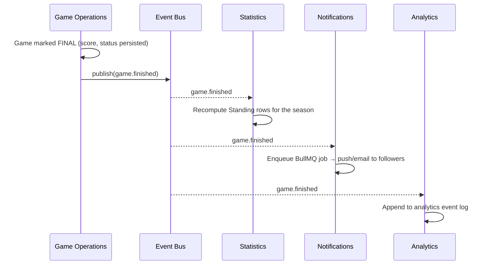
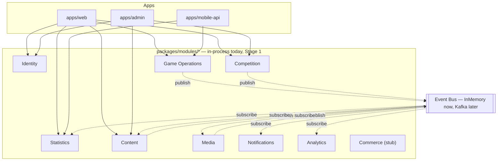
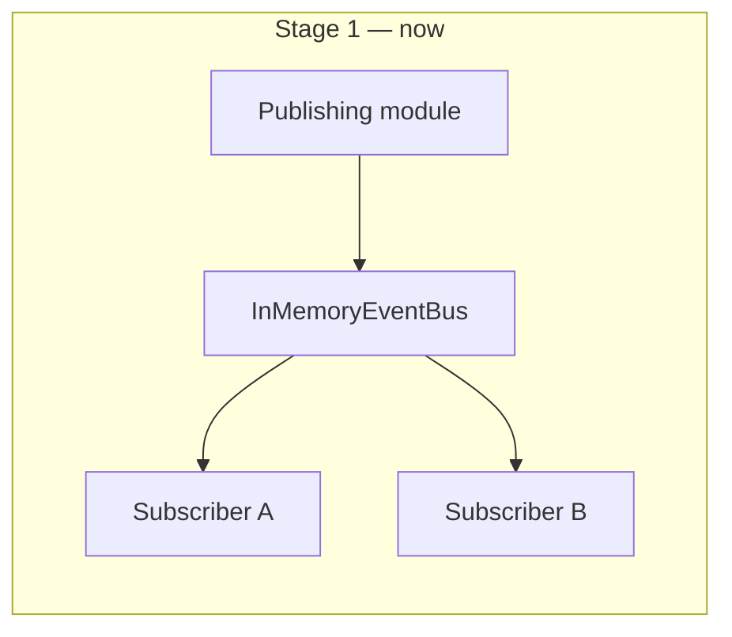
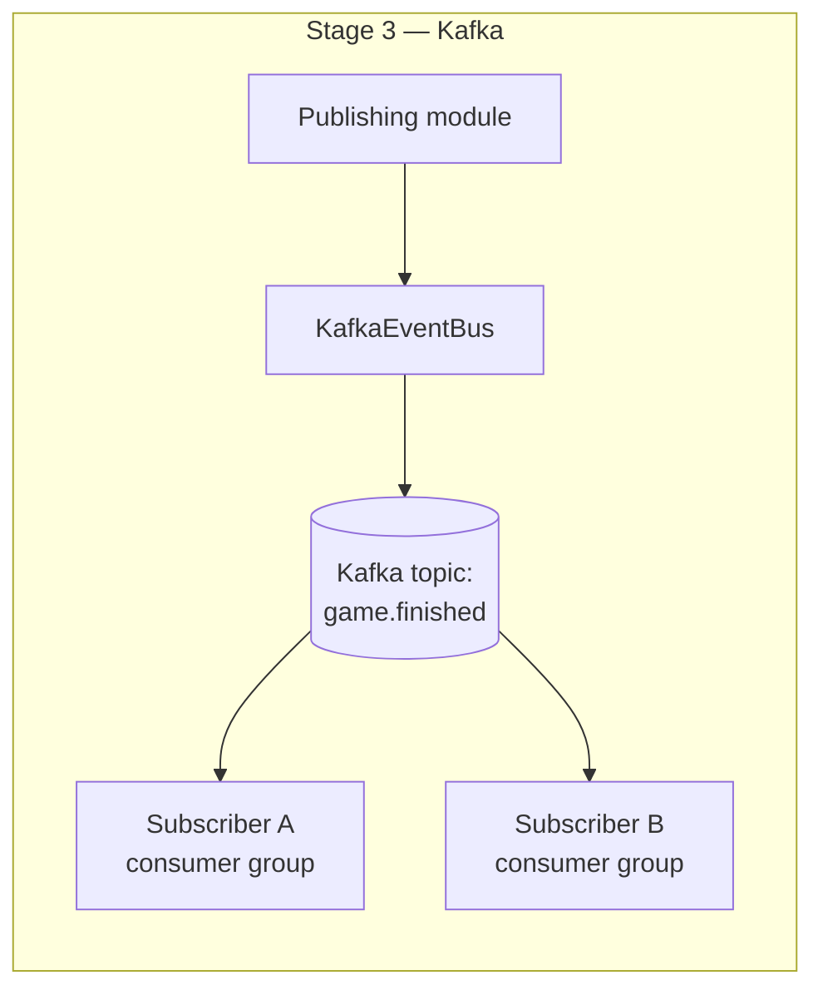
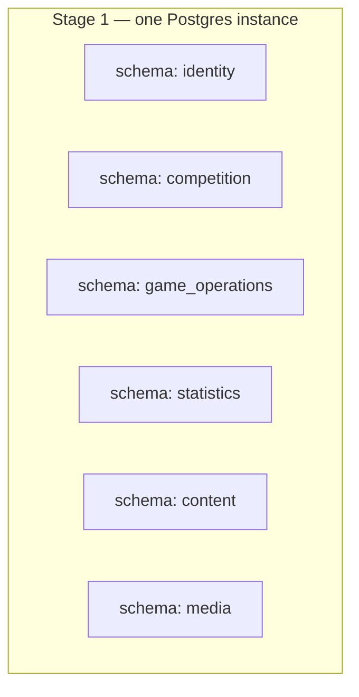
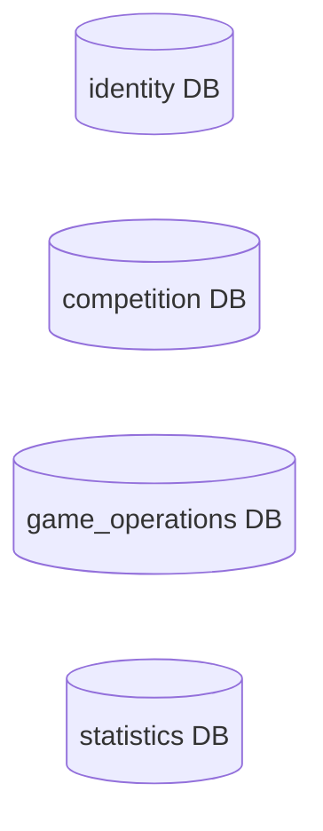
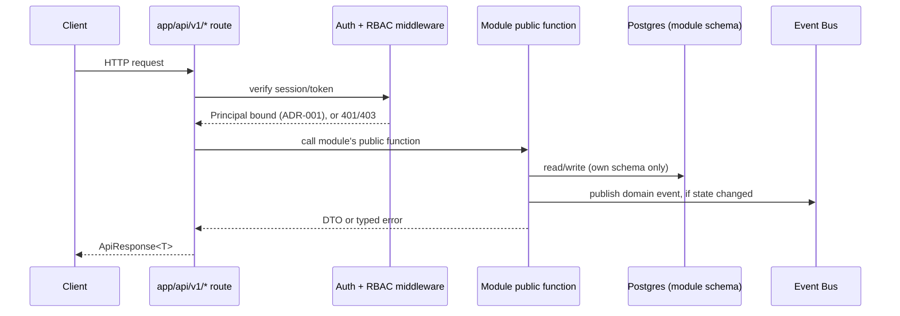

# Backend Architecture — Modular Monolith → Event-Driven Services

**Status: design document only. Nothing in this file is implemented.** No code, API route,
database model, or dependency described here exists in the repo yet — see
[roadmap.md](./roadmap.md) for what's actually built and when each piece is scheduled. This doc
exists so that when implementation starts, nobody re-derives the shape from scratch, exactly
like [future-services.md](./future-services.md) and [erd.md](./erd.md)'s "Future — not yet
migrated" section already do for their slice of the system. This document is the same kind of
artifact, scoped to the backend's internal structure instead of individual features.

**Naming note:** this document uses **Stage 1 / Stage 2 / Stage 3** to describe the backend's own
evolution (modular monolith → hybrid → Kafka/microservices). That is a *different axis* from
[roadmap.md](./roadmap.md)'s **Phase 0–5 / Future** (which tracks *product features* — Standings,
Accounts, Media, etc.). A given product phase can ship while the backend is still on Stage 1 —
the two timelines are related but not the same clock. Don't conflate "Phase 1" (League Hub, the
frontend milestone already in progress) with "Stage 1" (this doc's starting architecture).

Primary owner: **Chief Architect** agent, with **Backend Engineer** and **Database Engineer** as
close collaborators per [ai-workflow.md](./ai-workflow.md)'s routing rules. Extends
[architecture.md](./architecture.md) (still authoritative for the Next.js/Prisma stack, app
boundaries, and the services→RSC/API pattern) rather than replacing it — everything below is
built on top of those decisions, not instead of them.

---

## Table of contents

1. [Folder structure](#1-folder-structure)
2. [Module responsibilities](#2-module-responsibilities)
3. [Communication rules](#3-communication-rules)
4. [Event flow](#4-event-flow)
5. [Migration strategy: Internal Event Bus → Kafka](#5-migration-strategy-internal-event-bus--kafka)
6. [Database ownership](#6-database-ownership)
7. [Storage strategy](#7-storage-strategy)
8. [Redis usage](#8-redis-usage)
9. [BullMQ usage](#9-bullmq-usage)
10. [API layer](#10-api-layer)
11. [Authentication layer](#11-authentication-layer)
12. [Authorization (RBAC)](#12-authorization-rbac)
13. [Logging](#13-logging)
14. [Error handling](#14-error-handling)
15. [Validation](#15-validation)
16. [Security architecture](#16-security-architecture)
17. [Future scalability](#17-future-scalability)

---

## 1. Folder structure

Two new top-level concepts inside `packages/`, alongside everything [architecture.md](./architecture.md)
already documents. Nothing here moves or renames anything that exists today.

```
AZHL/
  apps/
    web/                # unchanged — see architecture.md. Calls modules in-process (Stage 1).
    admin/               # unchanged — same in-process module calls once Phase 4 makes it real.
    mobile-api/          # unchanged — same modules, reached the same way, once Future phase makes it real.
  packages/
    database/            # unchanged Prisma package — gains multi-schema mapping, see §6.
    types/                # unchanged shared DTOs.
    utils/                # unchanged shared helpers.
    ui/                   # unchanged shared UI primitives.
    config/               # unchanged shared tsconfig/eslint/prettier.

    modules/              # NEW — one package per business module (bounded context).
      identity/
        domain/           # entities, value objects — framework-agnostic, no Prisma/Next imports
        application/
          commands/        # write use-cases ("CreateUser", "AssignRole")
          queries/          # read use-cases
          event-handlers/   # this module's subscribers to OTHER modules' events
        infrastructure/
          repositories/     # the ONLY code in the repo allowed to run Prisma queries against
                            # this module's own tables
        events/
          identity.events.ts   # this module's OWN published event types + payload schemas
        index.ts            # PUBLIC API — the only file other packages/apps may import from
      competition/          # League, Season, Team, Player — same internal shape as above
      game-operations/       # Game, live scoring — same internal shape
      statistics/            # Standing, PlayoffSeries, Award (derived read models) — same shape
      content/                # NewsArticle — same shape
      media/                  # MediaAsset — same shape
      notifications/          # NotificationPreference, send channels — same shape
      analytics/               # event sink / BI export — same shape, mostly consumers, few commands
      commerce/                # Ticketing/Shop — Future phase, stub folder + README only for now

    platform/              # NEW — cross-cutting infrastructure. NOT a business module: no
                           # domain logic, no Prisma models of its own, every module depends on
                           # this, this depends on no module.
      event-bus/
        event-bus.interface.ts   # the abstraction everything codes against (§4, §5)
        in-memory-event-bus.ts    # Stage 1 implementation
        kafka-event-bus.ts        # Stage 3 implementation (added later, same interface)
        publisher-allowlist.ts     # EVENT_PUBLISHER_ALLOWLIST — derived from event-catalog.md's
                                   # Producer column; see docs/adr/ADR-002-event-bus-trust.md §2
        provenance.ts               # signed Provenance Claim mint/verify (EPK) for anything
                                    # crossing a process boundary — ADR-002 §5
        index.ts                 # composition root — constructs the active EventBus implementation
                                  # AND each module's bound publisher (ADR-002 §1); the only file
                                  # that ever sees a module's true identity alongside the raw
                                  # publish() function
      queue/
        queue.interface.ts        # thin wrapper describing "a named queue with add/process"
        bullmq-queue.ts            # BullMQ-backed implementation (§9)
      cache/
        cache.interface.ts
        redis-cache.ts             # (§8)
      storage/
        storage.interface.ts       # upload/getUrl/delete/signedUpload (§7)
        cloudinary-storage.ts
      security-context/
        principal.ts                 # branded Principal type { userId, roles, sessionId, kind } —
                                      # see docs/adr/ADR-001-inter-module-trust.md
        index.ts                     # PUBLIC exports ONLY: getCurrentPrincipal(), requirePrincipal()
                                      # — the bind/mint function is NOT in this file's exports and
                                      # is not importable from outside http-boundary, enforced via
                                      # this package's package.json `exports` map (ADR-001 §2)
      http-boundary/
        bind-principal.ts             # the ONLY code allowed to mint a real Principal — holds the
                                      # private capability Symbol from ADR-001 §2, consumed only by
                                      # the Next.js middleware/route entrypoints and the worker
                                      # bootstrap (ADR-001 §2)
      auth/
        rbac.ts                      # can(principal, action, resource) (§12) — principal is always
                                      # obtained via security-context, never a caller-supplied
                                      # parameter (docs/adr/ADR-001-inter-module-trust.md §5)
        privileged-operation.ts       # definePrivilegedOperation(permission, handler) — the required
                                      # wrapper for every module write (ADR-001 §6)
      logger/
        logger.interface.ts          # (§13)
      errors/
        domain-error.ts               # base classes every module's errors extend (§14)
      validation/
        env.schema.ts                  # boot-time environment validation (§15)
```

`pnpm-workspace.yaml` gains `"packages/modules/*"` and `"packages/platform/*"` entries when this
is actually built — not added now, since nothing exists there yet.

**Why `packages/` and not a new top-level `services/` or `modules/` directory?** A module is,
architecturally, exactly what [architecture.md](./architecture.md) already calls a package: a
pure library with a public entry point, importable by any app, never importing an app back. The
only thing new is that a module *additionally* owns a slice of the database and talks to its
peers over the Event Bus instead of being imported for direct data access. Keeping it under
`packages/` means the existing import rule ("apps import from packages, never the reverse")
already covers modules for free — no second rulebook to remember.

---

## 2. Module responsibilities

| Module | Owns (data) | Owns (behavior) | Does NOT own |
|---|---|---|---|
| **Identity** | User, Role, Session (Phase 4, per [erd.md](./erd.md#user--role--future-phase-4)) | Auth (login/session/token issuance), role assignment | Anything about what a role is *allowed to do inside another module* — that's the consuming module's own permission check (§12) |
| **Competition** | League, Season, Team, Player | League/season lifecycle (`SeasonStarted`/`SeasonFinished`), roster management, team/player CRUD | Live game state, standings — those are derived elsewhere |
| **Game Operations** | Game (score, status, period, venue) | Live scoring, game status transitions, `GameFinished`/`GoalScored` and other in-game events | Standings/stat aggregation — it only reports raw facts, never computes derived tables |
| **Statistics** | Standing, PlayoffSeries, Award (all derived/materialized — see [database-guidelines.md](./database-guidelines.md#soft-vs-hard-delete)'s existing note that `Standing` is "derived, never hand-edited," which this whole module generalizes) | Rebuilding standings/stats/awards **by consuming events**, never by querying Game Operations' or Competition's tables directly | Recording that a game happened — it only reacts to that fact |
| **Content** | NewsArticle | Publishing workflow, `NewsPublished` | Media files themselves (captions/attachments reference Media's assets by ID) |
| **Media** | MediaAsset | Upload handling, storage adapter calls, transcoding job orchestration, `MediaUploaded` | Where an asset is *displayed* — that's the consuming module/page's concern |
| **Notifications** | NotificationPreference | Subscribing to nearly every event type and turning "interesting" ones into actual sends (email/push) via its own BullMQ queue | Any business data — it reads just enough from event payloads (already denormalized, see §3) to compose a message |
| **Analytics** | Its own append-only event log / warehouse-facing tables | Ingesting every event for reporting/BI | Nothing transactional — if Analytics disappeared for an hour, no other module's correctness would be affected |
| **Commerce** *(Future phase, stub only)* | Order, Ticket (shape TBD, see [future-services.md](./future-services.md#ticketing-future-phase)) | Checkout, ticket issuance | Payment provider secrets (behind an adapter, same pattern as Media/Storage) |

**Platform** (`packages/platform/*`) is infrastructure, not a bounded context: Event Bus, Queue,
Cache, Storage, Auth primitives, Logger, error base classes, validation. Every module depends on
it; it depends on nothing business-specific. It never appears in the module list above because it
owns no domain data and makes no domain decisions.

---

## 3. Communication rules

These four rules are the entire point of this document — everything else is detail in service of
them:

1. **A module's Prisma models are only ever queried by that module's own `infrastructure/repositories/*`.**
   No other module, app, or route handler imports another module's repository or Prisma client
   directly. This is the direct extension of [architecture.md](./architecture.md)'s existing rule
   that only `lib/server/services/*` talks to Prisma — here, "services" is scoped down to "this
   one module's own services."
2. **Synchronous cross-module reads go through the owning module's public `index.ts` — never
   through its database.** If Notifications needs a user's email, it calls
   `identity.getUserContactInfo(userId)` (an exported, typed function), not
   `prisma.user.findUnique`. This is an in-process function call today (cheap, fast, same
   transaction boundary available if needed); it becomes a network call the day Identity is
   extracted, and nothing about *how Notifications asks the question* has to change — only what
   happens underneath the function call. **This function never accepts an identity/permissions
   parameter from its caller** — per
   [ADR-001](../../docs/adr/ADR-001-inter-module-trust.md), a module resolves *who is calling* via
   `requirePrincipal()`, an ambient, non-forgeable read, not a value the caller supplies.
3. **Everything else — anything that isn't "I need this one fact right now to complete my own
   request" — goes through the Event Bus, never a direct call.** A module never calls another
   module's command handlers to trigger side effects in that other module. Game Operations does
   not call Statistics to "please recompute standings" — it publishes `game.finished` and lets
   Statistics decide what that means for itself.
4. **No foreign keys across module schemas at the database level.** A module's tables may only
   reference its own module's tables. Cross-module relationships are by ID only, resolved via rule
   2 (a live lookup) or carried as a denormalized snapshot in an event payload (rule 3 — e.g.
   `game.finished`'s payload includes the team names/slugs at the time of the event, not just
   `homeTeamId`, so Notifications can compose a message without calling back into Competition).
   This is what makes §6's "single database today, separate databases later" story actually true
   instead of aspirational.

Rule of thumb for "should this be a direct call or an event?" — **direct call when the caller
needs an answer to proceed; event when the caller just needs to announce that something happened
and doesn't care who's listening or when they get to it.**

---

## 4. Event flow

### Event envelope

Every event on the bus, regardless of transport (Stage 1 in-memory or Stage 3 Kafka), has the same
shape:

```ts
interface DomainEvent<TPayload = unknown> {
  id: string;            // UUID — unique per event instance, used for consumer-side idempotency
  type: string;           // dot.case, versionable: "game.finished", "player.transferred"
  version: number;         // payload schema version for this event type (§5)
  occurredAt: string;      // ISO timestamp — when the fact became true in the domain
  producedAt: string;      // ISO timestamp — when it was published (may lag occurredAt slightly)
  correlationId: string;   // ties together a causally-related chain of events/requests
  causationId?: string;    // the id of the event/command that directly caused this one
  source: string;          // publishing module's name, e.g. "game-operations" — set only by the
                            // module's bound publisher (docs/adr/ADR-002-event-bus-trust.md §1),
                            // never a value the publishing module supplies itself
  payload: TPayload;       // denormalized enough that consumers rarely need a follow-up lookup
}
```

### Event Bus interface

```ts
interface EventBus {
  publish<T>(event: DomainEvent<T>): Promise<void>;
  subscribe<T>(eventType: string, handler: (event: DomainEvent<T>) => Promise<void>): void;
}
```

Every module's `application/event-handlers/*` registers subscribers against this interface only —
never against `InMemoryEventBus` or `KafkaEventBus` by name. That single rule is what makes §5
possible.

**A module never holds a direct reference to `publish()`/`subscribe()` on the raw `EventBus`.**
Per [ADR-002](../../docs/adr/ADR-002-event-bus-trust.md), the composition root hands each module a
*bound* publisher (its `source` fixed at wiring time, its allowed event types restricted to that
module's entry in `EVENT_PUBLISHER_ALLOWLIST`) — this is what prevents any module from publishing
an event under another module's identity, or publishing an event type it doesn't own (remediates
[security review finding C-2](../../docs/security/09-security-architecture-review.md#c-2-the-event-bus-has-no-publisher-authentication-or-event-type-authorization-at-either-stage)).

### Event catalog (Stage 1 starting set)

| Event | Published by | Typical subscribers |
|---|---|---|
| `season.started` | Competition | Statistics (initialize standings rows), Notifications, Analytics |
| `season.finished` | Competition | Statistics (finalize awards), Content, Notifications, Analytics |
| `game.finished` | Game Operations | Statistics, Notifications, Analytics |
| `game.goal_scored` | Game Operations | Notifications (live alerts), Analytics |
| `player.transferred` | Competition | Statistics, Notifications, Analytics |
| `news.published` | Content | Notifications, Analytics |
| `media.uploaded` | Media | Content (attach to an article), Analytics |

New events follow the same `<module>.<past-tense fact>` naming convention; a module publishes an
event for anything another part of the system could plausibly care about, not just this starting
list.

### Example flow: `game.finished`



Game Operations never knows Statistics, Notifications, or Analytics exist. Adding a fourth
subscriber later (e.g. a future "Highlights" module that auto-generates a recap) requires zero
changes to Game Operations — it already published everything a new subscriber needs.

### Module topology



---

## 5. Migration strategy: Internal Event Bus → Kafka

The entire strategy rests on §4's interface: nothing outside `packages/platform/event-bus/`
should ever know which implementation is active.

**Stage 1 — `InMemoryEventBus` (now).** A `Map<eventType, handler[]>` inside a single Node
process. `publish` calls each matching subscriber (via `queueMicrotask` so publishers don't block
on subscriber work). No persistence, no replay, no cross-process delivery — if the process
restarts mid-processing, that event's remaining subscribers never ran. Acceptable *only* because
Stage 1 is a single deployable where every module lives in the same request lifecycle; this
limitation is exactly what Stage 3 removes, not a bug to patch in Stage 1.

**Stage 2 — Redis Streams (optional, recommended bridge).** Once `apps/web` runs as more than one
instance (basic horizontal scaling, before any real microservice split), an in-memory bus stops
working — instance A's publish never reaches instance B's subscribers. Redis is already in the
stack for caching/BullMQ (§8, §9), so a `RedisStreamsEventBus` implementing the exact same
`EventBus` interface is a cheap, low-risk stepping stone: durable enough to survive a process
restart, simple consumer-group semantics via `XREADGROUP`, no new infrastructure to provision.
This stage is optional — a team that goes straight from one instance to Kafka can skip it — but
it's a real, low-cost option worth knowing about rather than jumping straight to Kafka's
operational overhead before it's justified.

**Stage 3 — `KafkaEventBus` (future).** Same `EventBus` interface, backed by KafkaJS.

- **Topic strategy:** one topic per event type (`game.finished`, `player.transferred`, ...) rather
  than one topic per module — keeps consumer filtering trivial (subscribe to the topic, get
  exactly that event type) at the cost of more topics to manage; revisit only if topic count
  becomes an operational problem.
- **Consumer groups per subscribing module** — Statistics, Notifications, and Analytics each run
  their own consumer group per topic, so scaling any one module's event processing is "add
  instances to its consumer group," independent of the others.
- **Producer ACLs, per [ADR-002](../../docs/adr/ADR-002-event-bus-trust.md) §8:** each extracted
  service authenticates to the Kafka cluster with its own credential, and broker-side ACLs enforce
  the exact same `EVENT_PUBLISHER_ALLOWLIST` data the in-process gate already enforces at Stage 1 —
  not a new authorization model, the same one at a different enforcement point. Every message
  additionally carries a signed Provenance Claim (ADR-002 §5), verified independently by each
  consumer as defense in depth beyond the broker's own ACL enforcement.
- **At-least-once delivery, idempotent consumers.** Kafka does not guarantee exactly-once end to
  end without transactional producers/consumers on both sides — cheaper and simpler to assume a
  handler might see the same `DomainEvent.id` twice and make every handler idempotent (a
  processed-event-ids table or Redis `SET` keyed on `id`, checked before acting).
- **Versioning:** the envelope's `version` field lets a consumer branch on payload shape;
  breaking payload changes ship as `type: "game.finished"`, `version: 2` rather than silently
  changing `version: 1`'s shape — same philosophy as `app/api/v1/*` vs `v2` in
  [api-guidelines.md](./api-guidelines.md).





### Cutover checklist

1. Build `KafkaEventBus` against the existing `EventBus` interface — no changes to any module's
   publish/subscribe call sites, because they never referenced `InMemoryEventBus` by name.
2. Provision a Kafka cluster (managed — Confluent Cloud/AWS MSK — preferred over self-hosting
   until there's a dedicated platform team to run it).
3. **Bake-in period:** run both buses side by side (publish to both, consumers read from Kafka but
   InMemory stays live as a fallback/comparison signal) long enough to trust delivery and ordering
   behavior before removing the old path — treat the event layer itself as something to blue/green,
   not just the application code on top of it.
4. Flip `EVENT_BUS_DRIVER=kafka` in production; keep `in-memory` as the default for local dev and
   tests (no developer needs a local Kafka cluster to run the app), so both implementations stay
   in the codebase indefinitely rather than one being deleted.

### What Kafka unlocks: module → microservice extraction

Only after Stage 3 is a module's extraction low-risk, because a module that only ever talked to
the rest of the system via events (rule 3) and a narrow public interface (rule 2) has no hidden
coupling to untangle:

1. Move the module's package (`packages/modules/<name>`) into its own deployable (its own
   `Dockerfile`/build, own process).
2. Give it its own Postgres database, seeded from its existing schema (§6 — this is a `pg_dump`/
   `pg_restore` of its own schema, not a data-modeling exercise, because rule 4 already forbade
   cross-schema foreign keys).
3. Point it at the same Kafka cluster — publish/subscribe code doesn't change, only its address.
4. Replace any in-process callers of its public `index.ts` (rule 2) with a thin HTTP or gRPC
   client implementing the *same function signatures* — the calling module's code changes at the
   call boundary only, not its own logic.
5. Retire the in-process import from whichever app used to bundle it.

---

## 6. Database ownership

**Stage 1: one physical Postgres database, one Postgres *schema* per module**, using Prisma's
multi-schema support (`multiSchema` in `datasource.schemas`, generally available in current Prisma
versions) so `Team` lives in Postgres schema `competition`, `Game` in `game_operations`,
`Standing` in `statistics`, and so on — while all still reachable through one `DATABASE_URL` and
one generated Prisma client during Stage 1.

- Each module's Prisma models are declared and migrated independently of other modules' models —
  no shared migration history to coordinate, even though they currently share one physical
  cluster.
- **Least-privilege DB roles, starting now, not deferred to extraction time:** each module
  connects using a Postgres role granted access to only its own schema. This costs nothing today
  and is exactly the boundary that makes "give this module its own database" a connection-string
  change plus a schema dump, not a security redesign done under pressure later.
- Rule 4 from §3 (no cross-schema foreign keys) is enforced by this physical separation — Postgres
  itself will refuse a foreign key into a schema the migration doesn't own.

**Stage 3: schema → own database.** When a module is extracted (§5's checklist), its Postgres
schema is dumped and restored into its own database instance, its `datasource` URL changes, and
nothing about its Prisma models changes, because they never referenced anything outside their own
schema.





---

## 7. Storage strategy

Generalizes the Cloudinary adapter already decided in
[future-services.md](./future-services.md#cloudinary-go-live-plan-phase-5) into a formal port
owned by the Media module and exposed through `packages/platform/storage`:

```ts
interface MediaStorage {
  upload(file: Buffer, meta: { contentType: string; folder: string }): Promise<{ url: string; id: string }>;
  getSignedUploadUrl(meta: { contentType: string; folder: string }): Promise<{ uploadUrl: string; id: string }>;
  delete(id: string): Promise<void>;
}
```

- **Stage 1 concrete adapter:** Cloudinary, exactly as already planned — env-var credentials, no
  live account until Phase 5, per the existing go-live plan. Nothing here changes that plan; this
  section just names the interface it implements.
- **Client uploads go direct-to-storage via signed URLs**, not proxied through the Node process —
  `getSignedUploadUrl` is what `apps/admin`'s upload UI calls; the browser then uploads straight to
  Cloudinary, and Media only ever handles the resulting metadata (`media.uploaded` event, §4).
  This keeps large file bodies off the API layer entirely.
- **Alternative adapter (documented, not chosen):** an S3-compatible implementation of the same
  interface, if a future requirement (cost, region, compliance) makes Cloudinary the wrong long-term
  fit — swapping is an adapter, not a rewrite, same philosophy as the Event Bus.

---

## 8. Redis usage

Redis serves four distinct purposes; keeping them conceptually separate matters because they have
different durability/latency requirements — **and, per
[ADR-003: Redis Security Architecture](../../docs/adr/ADR-003-redis-security.md), different
sensitivity and eviction-policy requirements that mean they do not all share one physical
instance.** ADR-003 groups purposes 1–4 below into two Stage-1 deployments
(`azhl-redis-critical` for security/queue-critical workloads, `azhl-redis-cache` for the
cross-instance cache described in point 1), each with its own least-privilege Redis ACL users, TLS,
and network isolation — remediating
[security review finding C-3](../../docs/security/09-security-architecture-review.md#c-3-redis-is-an-unhardened-undocumented-single-point-of-trust-concentration).
This section describes *what* Redis is used for; ADR-003 specifies *how each use is secured*.

1. **Cross-instance cache** for data multiple app instances (and, later, `apps/admin`/
   `apps/mobile-api`) need to share — standings, current season, schedule. This is *not* a
   replacement for `apps/web`'s existing `unstable_cache`/ISR/`revalidateTag` strategy
   ([architecture.md](./architecture.md#revalidation-strategy)) — that stays exactly as documented
   for Next.js's own render cache. Redis is for cache that must be consistent *across processes*,
   which a per-process Next.js cache structurally cannot be once there's more than one instance or
   more than one app reading the same data.
2. **BullMQ's required backing store** (§9) — job data, queues, and delayed-job scheduling all
   live in Redis because BullMQ is built directly on top of it.
3. **Real-time fan-out for live game state.** A `game.goal_scored` event needs to reach every
   browser with an open connection to that game, regardless of which app instance is holding that
   particular WebSocket/SSE connection. A small "Realtime Gateway" subscribes to the Event Bus and
   republishes to a Redis Pub/Sub channel; every app instance subscribes to Redis and forwards to
   its own locally-connected clients:

   ```mermaid
   graph LR
       GO[Game Operations] -.publish.-> EB[Event Bus]
       EB -.subscribe.-> RG[Realtime Gateway]
       RG -- PUBLISH --> R[(Redis Pub/Sub)]
       R -- SUBSCRIBE --> W1[Web instance 1]
       R -- SUBSCRIBE --> W2[Web instance 2]
       W1 --> Br1[Connected browsers]
       W2 --> Br2[Connected browsers]
   ```

4. **Rate limiting and distributed locks** — sliding-window counters for the public API layer
   (§10, §16), and simple locks (e.g. Redlock) for "only one process should recompute this
   season's standings at once" — cheap correctness for the rare cross-process race condition,
   without reaching for heavier distributed-coordination tooling.

---

## 9. BullMQ usage

**BullMQ and the Event Bus solve different problems and are not redundant with each other.** The
Event Bus is cross-module, fire-and-forget broadcast — a publisher doesn't know or care who's
listening, or whether "processing" even means retrying on failure. BullMQ is a single module's own
reliable execution of its own work — explicit retries, backoff, delay, and concurrency control for
tasks that specific module owns end to end.

Typical shape: a module's event handler receives something off the Event Bus and, if the resulting
work needs retry/backoff/rate-controlled execution, enqueues a BullMQ job to actually do it, rather
than doing it inline in the handler.

| Queue | Owned by | Triggered by | Why a queue and not inline |
|---|---|---|---|
| `notifications.send` | Notifications | `game.finished`, `news.published`, etc. | Email/push providers are flaky third parties — needs retry/backoff, not a blocking call inside an event handler |
| `media.transcode` | Media | `media.uploaded` | Video transcoding is slow and resource-heavy — must run out-of-band, with concurrency limits |
| `statistics.recompute` | Statistics | `game.finished`, `season.finished` | Recomputation over a full season's games should be debounced/batched, not run once per event on a busy game day |
| `analytics.export` | Analytics | Scheduled (cron-style BullMQ repeatable job) | Nightly batch export to a warehouse, independent of any single event |

- **Failure handling:** standard exponential backoff, capped retry count, then the job moves to a
  dead-letter queue for alerting/manual inspection — never silently dropped.
- **Observability:** `@bull-board` (or equivalent) gives an operational dashboard over queue depth,
  failures, and retries without building custom tooling.
- Queues are named `<module>.<action>`, matching the event-naming convention, so ownership is
  obvious from the name alone.

---

## 10. API layer

The existing contract in [api-guidelines.md](./api-guidelines.md) (`app/api/v1/*`, the
`ApiResponse<T>` envelope, thin route handlers, pagination conventions) **stays exactly as
documented** — this section describes how it sits on top of the module architecture, not a
replacement for it.

- A route handler under `app/api/v1/*` calls a module's public `index.ts` function (rule 2, §3),
  the same way it calls `lib/server/services/*` today — from the route handler's perspective,
  nothing changes; the module boundary is invisible to it.
- **No API gateway or BFF layer until a real need appears.** Introducing GraphQL, a gateway, or
  per-client aggregation endpoints before `apps/mobile-api` or third-party public-API consumers
  exist and have demonstrated a genuine shape mismatch with `v1` REST would be exactly the
  speculative complexity [engineering-principles.md](./engineering-principles.md) warns against.
  When/if that need appears, it's an addition in front of the existing `v1` contract, not a
  rewrite of it.
- **Internal service-to-service calls** (once any module is extracted per §5) start as plain
  internal HTTP with a small typed client per module's public interface — the same function
  signatures the in-process `index.ts` exposed, just over the network. Reach for gRPC only where a
  measured latency requirement (e.g. live game state polling) justifies the added complexity, not
  by default.
- **Public third-party API** (Future phase) reuses `v1`'s exact response/error shape and versioning
  policy; the only addition is API-key issuance and per-key rate limiting (§16), not a parallel
  contract.



---

## 11. Authentication layer

Builds on the Auth.js decision already made in [architecture.md](./architecture.md) (scaffolded
now, real in Phase 4) and the `User`/`Role` shape already sketched in
[erd.md](./erd.md#user--role--future-phase-4) — this section doesn't re-decide either, it places
them in the module architecture.

- **Browser sessions** (public site login, `apps/admin` dashboards): Auth.js, owned entirely by the
  Identity module. Session data never leaks into another module's database — every other module
  reads a verified **Principal** via `requirePrincipal()`, per rule 2 and
  [ADR-001](../../docs/adr/ADR-001-inter-module-trust.md), never a value passed to it as a
  parameter.
- **Mobile app / public API consumers**: short-lived JWT access tokens + refresh tokens, issued by
  Identity, verified by the same middleware layer regardless of which app the request hit — one
  verification implementation, reused everywhere, not reimplemented per app.
- **Server-to-server / third-party public API**: API keys scoped to a consumer, issued and
  revocable by Identity, checked at the API layer before a request ever reaches a module.
- In every case, **modules never verify credentials themselves** — they trust the Principal
  the middleware already resolved, the same way route handlers trust that a service function
  already validated its inputs. Authentication is a boundary concern, not scattered through
  business logic. **How that trust is made technically unforgeable, not just conventional, is
  specified in full in [ADR-001](../../docs/adr/ADR-001-inter-module-trust.md)** — this section
  states what each auth flow produces; that ADR states how the result can be trusted by every
  module that reads it.

---

## 12. Authorization (RBAC)

Extends the `Role` enum already planned in [erd.md](./erd.md#user--role--future-phase-4) (`FAN`,
`ADMIN`, `EDITOR` at minimum) with a small, explicit permission set per role rather than
hard-coded `if (role === "ADMIN")` checks scattered through the codebase:

| Role | Example permissions |
|---|---|
| `FAN` | `profile:read-own`, `profile:write-own`, `notification-preference:write-own` |
| `EDITOR` | everything `FAN` has, plus `content:publish`, `media:upload` |
| `ADMIN` | everything, including `roster:write`, `game:write`, `user:manage-roles` |

- `packages/platform/auth/rbac.ts` exposes one function, `can(principal: Principal, action: string, resource?: unknown): boolean`,
  used identically by every app and every module — one implementation of "is this allowed," not
  one per route. `principal` is always obtained via `requirePrincipal()`
  ([ADR-001](../../docs/adr/ADR-001-inter-module-trust.md)) — `can()` itself does not, and cannot,
  distinguish a genuine principal from a forged one; that guarantee is established once, upstream,
  by the mechanism ADR-001 specifies, not re-verified on every `can()` call.
- **Authorization checks happen at the API/middleware boundary** (§10's diagram) **and again at
  every privileged module operation**, via `definePrivilegedOperation()`
  ([ADR-001](../../docs/adr/ADR-001-inter-module-trust.md) §6) — a module's business logic assumes
  it's already been authorized to run only in the sense that the check is structural (built into
  the required wrapper every write goes through), not merely assumed and left unenforced. This
  keeps ad hoc `can()` calls out of business logic bodies, matching
  [architecture.md](./architecture.md)'s existing "route handlers are thin, services are the logic"
  split, while still guaranteeing the check actually happens.
- The permission set is additive and versionable — a new permission string is a safe, non-breaking
  addition; removing one from a role is the kind of change that needs the same care as an API
  breaking change (§10).

---

## 13. Logging

- A single `Logger` interface in `packages/platform/logger`, structured JSON output (not
  `console.log` string interpolation), so logs are queryable rather than grep-only from day one.
- Every log line carries `correlationId` (propagated from the incoming request or the triggering
  event's envelope, §4) so a single user action can be traced across every module and event handler
  it touched, even in Stage 1's single process — this pays for itself immediately in Stage 3, once
  "trace one request across three services" is otherwise a real debugging problem.
- **Levels:** `debug` (local dev only), `info` (normal operations — request completed, event
  published/consumed), `warn` (recovered from something, e.g. a retried job), `error` (needs
  attention).
- **Sink is swappable, same adapter philosophy as everything else:** stdout in local dev (readable,
  no setup); a real aggregator (Axiom, Datadog, Grafana Loki — concrete choice deferred, not
  decided here) once there's production infrastructure worth monitoring. The `Logger` interface
  doesn't change when the sink does.

---

## 14. Error handling

- `packages/platform/errors` defines a small base-class hierarchy every module's errors extend:
  `NotFoundError`, `ValidationError`, `ConflictError`, `UnauthorizedError`, `ForbiddenError` — each
  carrying a stable `code` matching [api-guidelines.md](./api-guidelines.md)'s existing
  `SCREAMING_SNAKE_CASE` convention (`NOT_FOUND`, `VALIDATION_ERROR`, ...), so the API layer's
  error-mapping step (already documented in api-guidelines.md) has one small, closed set of error
  types to translate into `ApiError`, instead of guessing at arbitrary thrown values.
- **A module never leaks its own internals in an error** — no raw Prisma error objects, no stack
  traces, cross the module boundary or the API boundary. A repository catches a Prisma-specific
  failure and re-throws one of the shared typed errors above.
- **Event handler failures** don't silently disappear: an event handler that throws is caught by
  the Event Bus wrapper, logged with the event's `id`/`correlationId`, and — if the resulting work
  matters enough to guarantee (as opposed to "best effort, next event will self-correct") — the
  handler should have enqueued a BullMQ job (§9) instead of doing the risky work inline, so retry
  semantics exist at all. Stage 1's `InMemoryEventBus` has no built-in redelivery; Stage 3's Kafka
  does (consumer offset not committed until success), which is one more concrete reason Stage 3
  meaningfully improves reliability, not just throughput.

---

## 15. Validation

- **One validation library, used everywhere** — request payloads (query/body) at the API layer,
  event payloads on both publish and consume (defense in depth: a publisher validates before
  putting something on the bus; a consumer validates again before acting on it, since Stage 3's
  Kafka doesn't guarantee a producer and consumer agree on shape indefinitely), and environment
  variables at process boot (`packages/platform/validation/env.schema.ts` — fail loudly at startup
  if a required var is missing, not at first use in production). Zod is the natural fit given this
  stack is TypeScript end to end and needs runtime validation that also yields a static type — not
  installed yet; picking it now just means implementation doesn't re-litigate the choice.
- **Schemas live next to the types they validate** — colocated with each module's DTOs/event
  payloads, not centralized in one giant schema file no one owns.
- Validation failures throw the shared `ValidationError` (§14), which the API layer already knows
  how to map to a `422` with field-level `details`, per the existing status-code table in
  [api-guidelines.md](./api-guidelines.md).

---

## 16. Security architecture

- **Secrets** — env vars only, provisioned per environment through the hosting platform's secret
  store (Vercel today, per [future-services.md](./future-services.md#vercel-go-live-plan-future-phase)),
  never committed; `.env.example` documents variable *names*, never real values. Nothing here
  changes that existing rule — it now also covers Kafka credentials, Redis URL, and any future
  module's third-party API keys.
- **Trust boundaries per app**, not one blanket policy: `apps/web` treats all client input as
  untrusted; `apps/admin` requires an authenticated session with an RBAC check on every write;
  `apps/mobile-api`/public API requires a valid token or API key plus per-key rate limiting (§8's
  Redis-backed limiter) before a request reaches any module.
- **Least-privilege database credentials per module** (§6) — not deferred to microservice
  extraction time, since it costs nothing to set up while everything still lives in one Postgres
  instance and is exactly the habit that makes extraction safe later.
- **CORS** is scoped per API surface: `apps/web`'s own routes need none (same-origin); a future
  public API defines an explicit allowed-origin policy per registered API key/client, not a
  wildcard.
- **Dependency and vulnerability scanning** stays a CI concern (Security Engineer agent,
  [ai-workflow.md](./ai-workflow.md)), unchanged by this document — the module split doesn't
  change how dependencies are audited, just how many `package.json`s exist to audit.
- **Audit logging** for every write performed under an `ADMIN`/`EDITOR` role — who, when, what
  changed — living in whichever module owns the changed data, published as a normal domain event
  so Analytics (and, later, a dedicated audit view) can consume it like anything else, rather than
  inventing a separate audit pipeline.

---

## 17. Future scalability

- **Horizontal scaling of `apps/web`** is a Stage 2 concern: stateless Next.js instances behind a
  load balancer (or Vercel's own scaling), Redis for the cache/session/pub-sub needs that a
  per-process cache can't serve (§8), no code change required in any module because they never
  assumed single-process affinity beyond Stage 1's `InMemoryEventBus` (which Stage 2 already
  addresses via Redis Streams).
- **Read replicas** for Postgres become worth it once any single module's read volume — most
  likely Statistics or Game Operations on a live game day — outgrows one primary instance. Because
  modules are already schema-isolated (§6), a read replica can be introduced for one module's
  schema without touching the others.
- **Statistics as a CQRS-lite read model, formalized, not new.** `Standing` being "derived, never
  hand-edited" is already exactly this pattern today, in miniature. This document generalizes it:
  every one of Statistics' tables is a read model rebuilt from Game Operations/Competition's
  published events, never written to except by Statistics' own event handlers — the module never
  needs to scale its *write* path, only recomputation throughput, which is a queue/consumer-group
  scaling problem (§9, §5), not a database design problem.
- **The module → microservice playbook (§5) is the core long-term scalability lever** — new
  capability generally means a new module (following the existing shape), not a growing pile of
  routes inside `apps/web`. Extraction only happens for a module that has outgrown living
  in-process (its own scaling profile, its own team, its own release cadence) — most modules may
  reasonably live in the monolith indefinitely; extraction is a tool for when it's actually needed,
  not a goal in itself.
- **Multi-region** is explicitly out of scope for this document — it's a real future question
  (data residency, replication lag, which module's data even needs it) that deserves its own
  design pass once there's a concrete driver (a real user base in a specific region, a compliance
  requirement), not a speculative answer here.
