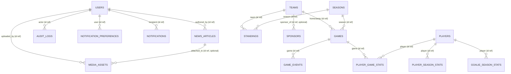
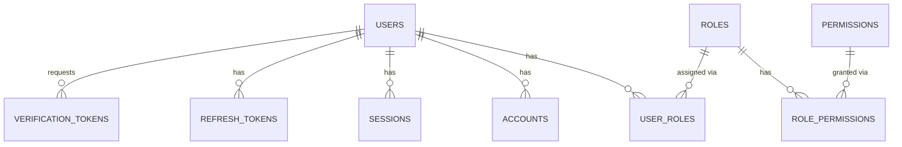
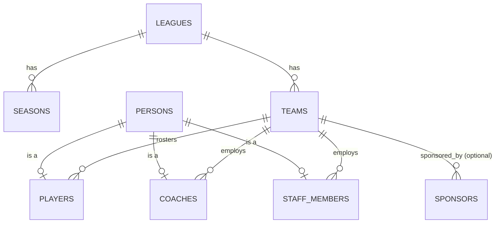
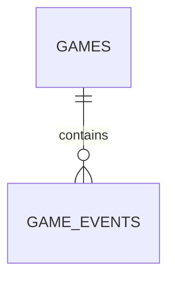
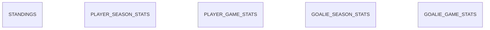
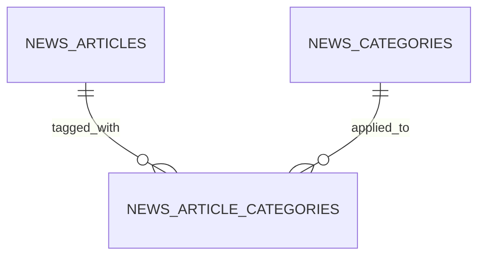

# AZHL Platform — Complete Database ERD (Design Only)

**Status: design document only.** No SQL, no Prisma schema, no migration exists yet for anything
in this file. This is the target-state relational design for the whole platform, built directly
on [backend-architecture.md](./backend-architecture.md)'s module boundaries — every table below
is assigned to exactly one Postgres **schema**, and that schema is exactly one of that document's
modules (§6, "one Postgres schema per module"). Where this design goes beyond what
[erd.md](./erd.md) already sketches for Phase 1, it supersedes that sketch for the *target*
shape; `erd.md` remains the accurate record of what's actually implemented in `schema.prisma`
today. Do not build any of this until its phase in [roadmap.md](./roadmap.md) arrives.

Primary owner: **Chief Architect** + **Database Engineer** agents.

---

## Table of contents

1. [Design conventions](#1-design-conventions)
2. [Schema map](#2-schema-map)
3. [Cross-schema relationship overview](#3-cross-schema-relationship-overview)
4. [`identity` schema — Authentication, Roles, Permissions](#4-identity-schema)
5. [`competition` schema — League, Teams, Players, Coaches, Staff, Sponsors](#5-competition-schema)
6. [`game_operations` schema — Games, Game Events](#6-game_operations-schema)
7. [`statistics` schema — Standings, Player/Goalie Statistics](#7-statistics-schema)
8. [`content` schema — News, Categories](#8-content-schema)
9. [`media` schema — Media Assets](#9-media-schema)
10. [`notifications` schema](#10-notifications-schema)
11. [`analytics` schema — Audit Logs](#11-analytics-schema)
12. [`platform` schema — System Settings](#12-platform-schema)
13. [Soft delete strategy, summarized](#13-soft-delete-strategy-summarized)
14. [Future scalability, summarized](#14-future-scalability-summarized)

---

## 1. Design conventions

Stated once here; each table below only notes where it *deviates* from these defaults.

- **Primary keys:** `id`, text, `cuid()` — matches
  [database-guidelines.md](./database-guidelines.md)'s existing convention exactly, for every
  low-to-moderate write-volume table (dimension/reference/entity tables — users, teams, players,
  news articles, etc.). **Exception:** the handful of very-high-insert-volume, append-only tables
  (`game_events`, `player_game_stats`, `goalie_game_stats`, `audit_logs`) use a `bigint`
  `GENERATED ALWAYS AS IDENTITY` primary key instead — `cuid`/UUIDv4-style random keys fragment a
  B-tree index badly at high insert rates (every insert lands in a random leaf page instead of the
  rightmost one), which matters once a table is receiving one row per goal/penalty/stat-line
  across every live game simultaneously. A sequential key keeps inserts append-only at the index
  level. If a future requirement needs these IDs to be globally unique *before* insert (e.g.
  client-generated IDs for offline-first mobile scoring), swap to UUIDv7 (time-ordered, so it
  keeps the same index-locality benefit) rather than back to `cuid`.
- **Timestamps:** every table has `created_at timestamptz not null default now()`. Tables whose
  rows are ever updated in place also have `updated_at timestamptz not null default now()`
  (application-maintained on every write, same as Prisma's `@updatedAt` today). Pure
  append-only/immutable tables (`game_events`, `audit_logs`) have `created_at` only — there is no
  "updated" for a fact that never changes after it happened.
- **Soft delete:** a nullable `deleted_at timestamptz` column, present **only** on tables where
  losing a row's history would be wrong (user-account-adjacent, editorial content, business
  records) — not a blanket default. See [§13](#13-soft-delete-strategy-summarized) for the
  full table and reasoning per table; each table's own section states its answer.
- **Naming:** tables are plural `snake_case`; columns are `snake_case`; foreign key columns are
  `<referenced_table_singular>_id` (`team_id`, `season_id`); every table lives in one of the
  schemas from [§2](#2-schema-map), written `schema.table` when it matters which.
- **Foreign keys never cross a schema boundary.** This is
  [backend-architecture.md](./backend-architecture.md)'s rule 4, restated in database terms: a
  `references` clause only ever points at a table in the *same* Postgres schema. Where one
  module's table needs to refer to another module's entity (a `game_events` row needs to know
  which team scored; a `notifications` row needs to know which user to notify), it stores the
  **ID as a plain column, with no foreign-key constraint**, and resolves it through the owning
  module's public interface when it needs more than the ID (exactly as described in
  backend-architecture.md §3, rule 2). Every such column is called out explicitly below as
  "cross-schema reference (no FK)."
- **Enums** for closed state sets (`game_status`, `player_position`, `notification_channel`, ...),
  matching [database-guidelines.md](./database-guidelines.md)'s existing stance — Postgres native
  `ENUM` types, one per schema that needs them.

---

## 2. Schema map

| Postgres schema | Owning module ([backend-architecture.md](./backend-architecture.md) §2) | Tables in this doc |
|---|---|---|
| `identity` | Identity | users, roles, permissions, role_permissions, user_roles, accounts, sessions, verification_tokens, refresh_tokens |
| `competition` | Competition | leagues, seasons, teams, persons, players, coaches, staff_members, sponsors |
| `game_operations` | Game Operations | games, game_events |
| `statistics` | Statistics | standings, player_season_stats, player_game_stats, goalie_season_stats, goalie_game_stats |
| `content` | Content | news_articles, news_categories, news_article_categories |
| `media` | Media | media_assets |
| `notifications` | Notifications | notification_preferences, notifications |
| `analytics` | Analytics | audit_logs |
| `platform` | *(cross-cutting infra, not a business module — see below)* | system_settings |

`system_settings` is the one table that doesn't belong to a business module. It's global,
cross-cutting configuration (feature flags, maintenance mode, site-wide toggles) that every
module may read but no single module "owns" the business meaning of — parking it in a neutral
`platform` schema, writable only by `ADMIN`, avoids arbitrarily making one business module
responsible for every other module's config.

---

## 3. Cross-schema relationship overview

Every arrow here is an **ID reference, not a foreign key** (per §1) — this diagram exists to show
*conceptual* ownership across the system, not enforced database constraints (those only ever
exist within a schema, per the per-schema diagrams below).

---

## 4. `identity` schema

### Diagram

`accounts`, `sessions`, and `verification_tokens` are shaped to match the Auth.js Prisma adapter's
required schema (already decided in [architecture.md](./architecture.md)) — they exist because
Auth.js needs them, not because this design invented them independently. `refresh_tokens` is
**not** an Auth.js table; it backs the separate mobile/public-API token flow described in
[backend-architecture.md](./backend-architecture.md) §11, which Auth.js's browser-session model
doesn't cover.

### `users`

- **Purpose:** one row per human account — fan, editor, or admin. The root identity every other
  `identity` table hangs off of, and the thing every other schema's cross-schema `user_id`
  columns point at.
- **Primary Key:** `id` (cuid)
- **Foreign Keys:** none
- **Indexes:** `(email)` — every login/lookup path resolves by email first
- **Unique Constraints:** `email`
- **Soft Delete:** yes — `deleted_at`. A user is never hard-deleted: their `id` is referenced by
  ID (not FK) from `news_articles.author_id`, `media_assets.uploaded_by`, `audit_logs.actor_id`,
  etc., across other schemas, and hard-deleting would silently orphan that history's meaning ("who
  published this?" becomes unanswerable). A real deletion/anonymization request (GDPR-style) is
  handled as a deliberate data-scrubbing operation on this row (null out PII, keep the `id` and
  `deleted_at`), not a `DELETE FROM users`.
- **Created At / Updated At:** yes
- **Scalability:** flat row-per-user scales to millions with just the email index; if the league
  ever needs social-login-heavy signup at scale, `accounts` (below) already isolates
  provider-specific identity from this table, so nothing here needs to change.

### `roles`

- **Purpose:** the closed set of roles a user can hold — `FAN`, `EDITOR`, `ADMIN` at minimum, per
  [erd.md](./erd.md#user--role--future-phase-4). A lookup table, not an enum, specifically so new
  roles are a data insert, not a schema migration + app redeploy.
- **Primary Key:** `id` (cuid)
- **Foreign Keys:** none
- **Indexes:** none beyond the PK — tiny, fully cached table (a handful of rows)
- **Unique Constraints:** `name`
- **Soft Delete:** no — roles are admin-managed reference data; removing one is a deliberate,
  rare, hard delete after confirming no `user_roles` reference it (enforced by the FK itself,
  `ON DELETE RESTRICT`)
- **Created At / Updated At:** yes
- **Scalability:** none needed — this table never grows past a few dozen rows even at full
  platform maturity

### `permissions`

- **Purpose:** the closed set of fine-grained permission strings
  (`content:publish`, `media:upload`, `roster:write`, ...) referenced by
  [backend-architecture.md](./backend-architecture.md) §12's `can()` check.
- **Primary Key:** `id` (cuid)
- **Foreign Keys:** none
- **Indexes:** none beyond the PK
- **Unique Constraints:** `key` (the `"content:publish"`-style string itself)
- **Soft Delete:** no — same reasoning as `roles`
- **Created At / Updated At:** yes
- **Scalability:** none needed

### `role_permissions`

- **Purpose:** many-to-many join — which permissions each role grants.
- **Primary Key:** composite `(role_id, permission_id)` — a pure join row has no reason to need
  its own surrogate `id`
- **Foreign Keys:** `role_id → roles.id` (`ON DELETE CASCADE` — deleting a role deletes its grants,
  not the permissions themselves); `permission_id → permissions.id` (`ON DELETE CASCADE`)
- **Indexes:** the composite PK already covers "permissions for this role"; add
  `(permission_id)` for the reverse "which roles grant this permission" lookup (used rarely, by
  admin tooling, but cheap to have)
- **Unique Constraints:** the composite PK itself is the uniqueness guarantee
- **Soft Delete:** no — a grant either exists or doesn't; there's no meaningful "soft-deleted
  grant"
- **Created At / Updated At:** `created_at` only — a grant is added or removed, never "updated in
  place"
- **Scalability:** none needed — bounded by roles × permissions, always small

### `user_roles`

- **Purpose:** many-to-many join — which roles each user holds. Many-to-many (not a single
  `role_id` on `users`) specifically so a person can hold more than one role at once (e.g. a
  content `EDITOR` who is also a `FAN` with a personal profile) — the more common single-role-per-user
  case is just the degenerate case of a user having exactly one row here.
- **Primary Key:** composite `(user_id, role_id)`
- **Foreign Keys:** `user_id → users.id` (`ON DELETE CASCADE`); `role_id → roles.id`
  (`ON DELETE RESTRICT` — don't let a role deletion silently strip users of it without a
  deliberate reassignment)
- **Indexes:** composite PK covers "roles for this user"; add `(role_id)` for "all users with this
  role" (used by admin dashboards)
- **Unique Constraints:** the composite PK
- **Soft Delete:** no — same reasoning as `role_permissions`
- **Created At / Updated At:** `created_at` only
- **Scalability:** grows linearly with users × average roles per user (typically 1) — no concern

### `accounts` *(Auth.js adapter table)*

- **Purpose:** links a `users` row to an external OAuth/identity provider (Google, etc.), per
  Auth.js's Prisma adapter contract.
- **Primary Key:** `id` (cuid)
- **Foreign Keys:** `user_id → users.id` (`ON DELETE CASCADE`)
- **Indexes:** `(user_id)`
- **Unique Constraints:** `(provider, provider_account_id)` — one linked account per provider per
  external ID
- **Soft Delete:** no — unlinking a provider is a real delete; the `users` row (soft-deletable)
  is what carries account history, not this join
- **Created At / Updated At:** yes
- **Scalability:** none needed; shape is fixed by Auth.js, not by this platform's growth

### `sessions` *(Auth.js adapter table)*

- **Purpose:** active browser sessions, per Auth.js's database-session strategy.
- **Primary Key:** `id` (cuid)
- **Foreign Keys:** `user_id → users.id` (`ON DELETE CASCADE`)
- **Indexes:** `(user_id)`; `(expires)` for the cleanup job that purges expired sessions
- **Unique Constraints:** `session_token`
- **Soft Delete:** no — an expired/logged-out session is deleted outright, never needed again
- **Created At / Updated At:** `created_at` only, plus Auth.js's own `expires` column
- **Scalability:** high row-churn (created/deleted constantly) but tiny row size — a routine
  cleanup job (BullMQ scheduled, per
  [backend-architecture.md](./backend-architecture.md) §9) deletes expired rows so the table
  doesn't grow unbounded; if Auth.js's JWT session strategy is adopted instead of database
  sessions, this table shrinks to near-empty and stops being a concern at all

### `verification_tokens` *(Auth.js adapter table)*

- **Purpose:** email verification / passwordless sign-in tokens, per Auth.js's adapter contract.
- **Primary Key:** composite `(identifier, token)`
- **Foreign Keys:** none (Auth.js's own design — not tied to `users.id` directly, since the user
  may not exist yet at verification time, e.g. first-time email sign-in)
- **Indexes:** `(expires)` for cleanup
- **Unique Constraints:** the composite PK; `token`
- **Soft Delete:** no — single-use, deleted on consumption or expiry
- **Created At / Updated At:** none — ephemeral by design
- **Scalability:** self-limiting (short-lived rows, routine cleanup)

### `refresh_tokens`

- **Purpose:** long-lived refresh tokens for the mobile app / public API's JWT access-token flow
  ([backend-architecture.md](./backend-architecture.md) §11) — a distinct mechanism from Auth.js's
  browser `sessions`, because a mobile client shouldn't need a browser cookie-session to stay
  logged in for weeks.
- **Primary Key:** `id` (cuid)
- **Foreign Keys:** `user_id → users.id` (`ON DELETE CASCADE`)
- **Indexes:** `(user_id)`; `(token_hash)` for the lookup on refresh
- **Unique Constraints:** `token_hash` — the token itself is **never stored raw**, only its hash
  (same principle as a password hash — a leaked database dump shouldn't hand out usable tokens)
- **Soft Delete:** no — revocation is modeled as a real `revoked_at timestamptz` column (distinct
  from soft-delete semantics: a revoked token is a meaningful *state*, checked on every refresh
  attempt, not a hidden-from-queries row)
- **Created At / Updated At:** `created_at` only, plus `expires_at` and `revoked_at`
- **Scalability:** one row per active device per user — bounded and small; a scheduled cleanup job
  removes long-expired/revoked rows, same pattern as `sessions`

---

## 5. `competition` schema

### Diagram

**Why a `persons` base table.** [erd.md](./erd.md)'s current `Player` model holds only
`fullName`/`jerseyNumber`/`position` — enough for Phase 1's placeholder roster, but this task asks
for a *complete* design that also includes Coaches and Staff. Those three roles share the same
underlying bio data (name, date of birth, nationality, photo) and, realistically, the same human
being can hold different roles over a career (a retired player becoming a coach is one of the most
common things that happens in a real league). Rather than duplicating name/DOB/nationality/photo
across three tables, `persons` holds the shared bio data once; `players`, `coaches`, and
`staff_members` each hold a **unique, one-to-one** foreign key back to `persons` plus only the
fields specific to that role. This is the standard relational pattern for "one real-world entity,
several role-specific extensions" (class-table inheritance) — the simpler alternative (three fully
independent tables, bio fields duplicated) is viable too and is a legitimate scope-reduction if the
extra join isn't worth it; this design recommends the shared-`persons` version as the
better long-term shape.

### `leagues`

- **Purpose:** the top-level competition entity — AZHL itself. Already implemented in Phase 1
  ([erd.md](./erd.md#league--implemented)); unchanged by this design beyond schema placement.
- **Primary Key:** `id` (cuid)
- **Foreign Keys:** none
- **Indexes:** none beyond PK — single-digit row count for the foreseeable future
- **Unique Constraints:** `slug`
- **Soft Delete:** no — a league is foundational reference data; there is currently exactly one,
  and removing it would cascade-orphan the entire platform, which should never be a soft-delete
  toggle
- **Created At / Updated At:** yes
- **Scalability:** none needed

### `seasons`

- **Purpose:** one competitive season within a league (already implemented). Anchors `games` and
  `standings` to a specific year's competition.
- **Primary Key:** `id` (cuid)
- **Foreign Keys:** `league_id → leagues.id` (`ON DELETE CASCADE`)
- **Indexes:** `(league_id, is_current)` — resolving "the current season" is the single most common
  query in the whole platform (already an indexed pattern per
  [database-guidelines.md](./database-guidelines.md))
- **Unique Constraints:** none beyond the PK (a league could legitimately have two season rows with
  overlapping labels in edge cases — e.g. a lockout-shortened season — so label uniqueness isn't
  enforced at the DB level)
- **Soft Delete:** no — same reasoning as `leagues`; a past season is historical record, never
  deleted, just no longer `is_current`
- **Created At / Updated At:** yes
- **Scalability:** one row per year, indefinitely — never a concern

### `teams`

- **Purpose:** a club competing in the league (already implemented).
- **Primary Key:** `id` (cuid)
- **Foreign Keys:** `league_id → leagues.id` (`ON DELETE CASCADE`)
- **Indexes:** `(league_id)`
- **Unique Constraints:** `slug`; `abbreviation`
- **Soft Delete:** yes — `deleted_at`. Unlike `leagues`/`seasons`, a team *can* legitimately fold
  or be rebranded; its historical games/standings/players must remain queryable, so removing a
  team from active display is a soft delete, not a cascade-delete of years of game history.
- **Created At / Updated At:** yes
- **Scalability:** bounded by league size (single digits to low dozens) — no concern

### `persons`

- **Purpose:** shared biographical data for anyone who is a player, coach, or staff member (see
  rationale above).
- **Primary Key:** `id` (cuid)
- **Foreign Keys:** none
- **Indexes:** none beyond PK
- **Unique Constraints:** none (two different real people can share a name/DOB; nothing here is
  naturally unique)
- **Soft Delete:** yes — `deleted_at`, for the same reason as `users`: other rows may reference a
  person's `id` for historical display (a retired player's career stats shouldn't vanish)
- **Created At / Updated At:** yes
- **Scalability:** grows with total lifetime roster/staff size, never transactionally hot — no
  concern

### `players`

- **Purpose:** the player-specific extension of a `persons` row — jersey number, position, current
  team.
- **Primary Key:** `id` (cuid)
- **Foreign Keys:** `person_id → persons.id` (`ON DELETE RESTRICT`, **unique** — enforces the 1:1
  relationship); `team_id → teams.id` (`ON DELETE CASCADE` — matches today's actual schema
  behavior, per [database-guidelines.md](./database-guidelines.md)'s current stance that Phase 1
  roster data cascades with its team)
- **Indexes:** `(team_id)` — roster-by-team lookups, already an existing index today
- **Unique Constraints:** `person_id`; `(team_id, jersey_number)` — matches today's existing
  constraint exactly
- **Soft Delete:** yes — `deleted_at` (a player leaving the league entirely, as opposed to being
  transferred, which is a `team_id` change plus a `player.transferred` domain event, not a
  delete)
- **Created At / Updated At:** yes
- **Scalability:** **future consideration, explicitly deferred here per this doc's own scope
  discipline** — a `team_id` that only ever points at a player's *current* team loses history the
  moment a player is transferred (the old team's roster page can no longer show "who played here in
  2026"). A season-scoped roster-history table (`team_id` + `season_id` + `player_id`) is the
  correct fix, but it isn't part of this request's table list, so it's noted here as the known next
  step rather than built speculatively now.

### `coaches`

- **Purpose:** the coach-specific extension of a `persons` row.
- **Primary Key:** `id` (cuid)
- **Foreign Keys:** `person_id → persons.id` (`ON DELETE RESTRICT`, unique); `team_id → teams.id`
  (`ON DELETE SET NULL` — a coach between teams is a real, common state; unlike a player's roster
  slot, a coach isn't cascade-deleted just because their prior team affiliation ended)
- **Indexes:** `(team_id)`
- **Unique Constraints:** `person_id`
- **Soft Delete:** yes — `deleted_at`
- **Created At / Updated At:** yes
- **Scalability:** same season-history caveat as `players`, same reasoning for deferring it

### `staff_members`

- **Purpose:** the staff-specific extension of a `persons` row — trainers, equipment managers,
  front-office roles, etc.
- **Primary Key:** `id` (cuid)
- **Foreign Keys:** `person_id → persons.id` (`ON DELETE RESTRICT`, unique); `team_id → teams.id`
  (`ON DELETE SET NULL`, same reasoning as `coaches`)
- **Indexes:** `(team_id)`
- **Unique Constraints:** `person_id`
- **Soft Delete:** yes — `deleted_at`
- **Created At / Updated At:** yes; plus a `title` column (free text — "Equipment Manager",
  "Athletic Trainer") since, unlike `players`' closed `position` enum, staff titles are an open,
  organically-growing set not worth an enum
- **Scalability:** same as `coaches`

### `sponsors`

- **Purpose:** sponsors and partners — modeled as **one table**, not two. The originally-requested
  "Sponsors" and "Partners" are the same shape (name, logo, a link, a tier) with no structural
  difference between them — the platform's own existing partner placeholder data already treats
  them this way (`tier: "official" | "partner"`). Two near-identical tables would just be the same
  entity modeled twice; a `tier` column captures the distinction that actually matters for display
  ("Official Partner" vs. general sponsor) without duplicating the table.
- **Primary Key:** `id` (cuid)
- **Foreign Keys:** `team_id → teams.id`, nullable (`ON DELETE SET NULL`) — most sponsors are
  league-wide, but a team-specific sponsorship is representable without a separate table
- **Indexes:** `(team_id)`
- **Unique Constraints:** none (two sponsors can share a display name in principle; nothing
  naturally unique here beyond the PK)
- **Soft Delete:** yes — `deleted_at` (a lapsed sponsorship shouldn't vanish from historical
  season pages that credited it)
- **Created At / Updated At:** yes
- **Scalability:** small table indefinitely — no concern

---

## 6. `game_operations` schema

### Diagram

**A `game_events` row is not the same thing as an Event Bus `DomainEvent`.** This is worth stating
plainly because the vocabulary collides: `game_events` is a **database table** recording facts that
happened during a specific game (a goal, a penalty, a period start). Inserting one of these rows is
typically what *triggers* Game Operations to `publish()` a `game.goal_scored` **domain event** on
the Event Bus ([backend-architecture.md](./backend-architecture.md) §4) for other modules to react
to. The table is the durable record; the bus message is the notification that the record was
created. One typically causes the other; they are not the same object.

### `games`

- **Purpose:** one scheduled/played matchup (already implemented).
- **Primary Key:** `id` (cuid)
- **Foreign Keys:** `season_id → seasons.id` (`ON DELETE CASCADE`); `home_team_id`,
  `away_team_id` — **cross-schema references to `competition.teams.id`, no FK** (per §1's rule —
  `game_operations` may not have a foreign key into `competition`). Referential integrity for these
  two columns is enforced at the application layer (Game Operations' write path validates the team
  IDs exist by calling Competition's public interface before insert), not by Postgres.
- **Indexes:** `(season_id, start_time)` (schedule queries); `(home_team_id)`; `(away_team_id)`
  (team-schedule lookups) — matches today's existing indexes exactly
- **Unique Constraints:** none today (a rematch on the same day is legitimate); see
  [database-guidelines.md](./database-guidelines.md)'s existing note on adding a synthetic unique
  key if idempotent reseeding is ever needed
- **Soft Delete:** no — a scheduled game that's cancelled is modeled as a `status` transition
  (`POSTPONED`, or a future `CANCELLED` value), not a deleted row; a game is a fact of the
  schedule even if it never happens
- **Created At / Updated At:** yes
- **Scalability:** rows-per-season is small and bounded (round-robin schedule size); no concern
  even after many seasons

### `game_events`

- **Purpose:** the event-sourced log of everything that happened inside a game — goals, penalties,
  period boundaries. This is the durable source Statistics' derived tables (§7) are rebuilt from,
  and the thing whose insertion typically triggers a domain-event publish.
- **Primary Key:** `id` **bigint identity** (per §1 — this is the highest-insert-volume table in
  the whole platform on a live game day)
- **Foreign Keys:** `game_id → games.id` (`ON DELETE CASCADE` — a game's event log has no meaning
  without the game). `player_id` (who scored/was penalized) is a **cross-schema reference to
  `competition.players.id`, no FK** — same reasoning as `games.home_team_id` above.
- **Indexes:** `(game_id, occurred_at)` — the primary access pattern is "every event for this game,
  in order," for building a play-by-play view
- **Unique Constraints:** none — multiple identical-looking events (two goals by the same player in
  the same minute of different periods) are legitimate
- **Soft Delete:** no — an event log entry is immutable once written; a scoring correction is
  modeled as a new corrective event (e.g. an explicit `event_type = 'goal_reversed'` row
  referencing the original), never an edit or delete, so the log stays a true append-only audit
  trail of what was recorded and when
- **Created At:** yes (no `updated_at` — see §1)
- **Scalability:** **the clearest partitioning candidate in the whole schema.** Native PostgreSQL
  table partitioning by `season_id` (range or list partitioning) keeps each season's slice small
  and keeps old seasons' partitions eligible for cheaper/cold storage tiers, without any
  application-level query change (Postgres routes to the right partition transparently). Worth
  planning for once total row count starts climbing into the millions, not before.

---

## 7. `statistics` schema

### Diagram

No foreign keys within this schema connect these tables to each other — each is an independently
rebuilt read model, keyed by cross-schema `season_id`/`team_id`/`player_id`/`game_id` references
(no FK, per §1). This is deliberate: every table here is a projection Statistics rebuilds by
consuming `game_operations`/`competition` events
([backend-architecture.md](./backend-architecture.md) §17's "CQRS-lite" framing) — none of them are
hand-edited, and none of them need to reference each other directly because they're all derived
from the same upstream facts independently.

### `standings`

- **Purpose:** one row per team per season — the already-implemented, already-"derived, never
  hand-edited" table this whole schema generalizes.
- **Primary Key:** `id` (cuid)
- **Foreign Keys:** none within `statistics`; `season_id` and `team_id` are cross-schema
  references (no FK)
- **Indexes:** `(season_id, rank)` — matches today's existing index
- **Unique Constraints:** `(season_id, team_id)` — matches today's existing constraint
- **Soft Delete:** no — derived data has no "delete," only recomputation
- **Created At / Updated At:** `updated_at` only, matching today's exact existing shape (there's
  no meaningful "created" moment for a wholesale-recomputed row)
- **Scalability:** trivially small (rows = seasons × teams) — no concern

### `player_season_stats`

- **Purpose:** one row per skater per season — goals, assists, points, games played, penalty
  minutes. The materialized answer to "what are this player's season totals," rebuilt from
  `player_game_stats` (below) whenever a game finishes.
- **Primary Key:** `id` (cuid)
- **Foreign Keys:** none within schema; `season_id` and `player_id` are cross-schema references
  (no FK)
- **Indexes:** `(season_id, points DESC)` — directly serves the stat-leaderboard query pattern
  ("top scorers this season"); `(player_id)` for a player profile's own season-by-season history
- **Unique Constraints:** `(season_id, player_id)` — one aggregate row per player per season
- **Soft Delete:** no — derived, recomputed wholesale, same as `standings`
- **Created At / Updated At:** `updated_at` only
- **Scalability:** rows = seasons × active skaters — small indefinitely

### `player_game_stats`

- **Purpose:** one row per skater per game — the finer-grained fact table `player_season_stats`
  is aggregated from, and what backs a single game's box score / a player's per-game log.
- **Primary Key:** `id` **bigint identity** (§1 — high insert volume, one batch per game finishing)
- **Foreign Keys:** none within schema; `game_id` and `player_id` are cross-schema references
  (no FK)
- **Indexes:** `(game_id)` (box score for one game); `(player_id, game_id)` (a player's game log,
  ordered)
- **Unique Constraints:** `(game_id, player_id)` — one line per player per game
- **Soft Delete:** no — same reasoning as `game_events`; a correction is a new/updated aggregate
  recomputation, not a deleted row
- **Created At / Updated At:** yes (this one *can* be updated in place — e.g. a late scoring
  correction recomputes the same game's line rather than inserting a duplicate)
- **Scalability:** rows = games × roster size per team — grows steadily; the same
  season-based partitioning note from `game_events` applies here once volume justifies it

### `goalie_season_stats`

- **Purpose:** one row per goaltender per season — wins, goals-against average, save percentage,
  shutouts. Structurally separate from `player_season_stats` because goaltending is measured on
  fundamentally different stats (rate-based: GAA, SV%) than skater counting stats, not because of
  any technical constraint — forcing them into one wide table would mean mostly-null columns for
  whichever position doesn't apply.
- **Primary Key:** `id` (cuid)
- **Foreign Keys:** none within schema; `season_id` and `player_id` are cross-schema references
  (no FK)
- **Indexes:** `(season_id, wins DESC)` (goalie leaderboard, matching the actual `/stats` page's
  existing "Goalies" leaderboard sort); `(player_id)`
- **Unique Constraints:** `(season_id, player_id)`
- **Soft Delete:** no
- **Created At / Updated At:** `updated_at` only
- **Scalability:** rows = seasons × active goaltenders — smaller than the skater table, no concern

### `goalie_game_stats`

- **Purpose:** per-game goaltending line (shots faced, goals allowed, save percentage, decision)
  underlying `goalie_season_stats`, mirroring `player_game_stats`'s relationship to
  `player_season_stats`.
- **Primary Key:** `id` **bigint identity**
- **Foreign Keys:** none within schema; `game_id` and `player_id` cross-schema references (no FK)
- **Indexes:** `(game_id)`; `(player_id, game_id)`
- **Unique Constraints:** `(game_id, player_id)`
- **Soft Delete:** no
- **Created At / Updated At:** yes
- **Scalability:** rows = games × goaltenders used per game (typically 1–2 per team) — smallest of
  the fact tables, no real concern, though the same partitioning option exists if ever needed

---

## 8. `content` schema

### Diagram

### `news_articles`

- **Purpose:** editorial content (already implemented).
- **Primary Key:** `id` (cuid)
- **Foreign Keys:** none within schema; `author_id` is a cross-schema reference to
  `identity.users.id` (no FK) — resolved via Identity's public interface when a byline needs
  display data
- **Indexes:** `(published_at)` — matches today's existing index and the news list's default
  ordering
- **Unique Constraints:** `slug`
- **Soft Delete:** yes — `deleted_at`. Unlike Phase 1's current hard-delete-everything stance,
  editorial content is exactly the "user-authored, benefits from an undo" case
  [database-guidelines.md](./database-guidelines.md) already flags as the trigger for revisiting
  soft-delete policy — retracting a published article should be reversible, not destructive.
- **Created At / Updated At:** yes
- **Scalability:** grows steadily but stays small relative to stat/event tables; `published_at`
  indexing plus standard pagination (already documented in
  [api-guidelines.md](./api-guidelines.md)) is sufficient indefinitely

### `news_categories`

- **Purpose:** the requested "Categories" — a managed lookup list ("Club News", "League
  Announcements", "Transactions", ...) rather than free-text tagging, so category-driven
  navigation/filtering stays reliable.
- **Primary Key:** `id` (cuid)
- **Foreign Keys:** none
- **Indexes:** none beyond PK — small, fully-cached table
- **Unique Constraints:** `slug`; `name`
- **Soft Delete:** no — categories are structural taxonomy, not content; removed via hard delete
  after confirming (via the join table's FK) nothing still references it
- **Created At / Updated At:** yes
- **Scalability:** none needed

### `news_article_categories`

- **Purpose:** many-to-many join — an article can carry more than one category (e.g. a piece that's
  both "Transactions" and "Club News"), which a single `category_id` column on `news_articles`
  couldn't express.
- **Primary Key:** composite `(news_article_id, news_category_id)`
- **Foreign Keys:** `news_article_id → news_articles.id` (`ON DELETE CASCADE`);
  `news_category_id → news_categories.id` (`ON DELETE RESTRICT` — don't let a category deletion
  silently un-tag every article that used it)
- **Indexes:** composite PK covers "categories for this article"; add `(news_category_id)` for
  "all articles in this category" (the actual category-browse page's query)
- **Unique Constraints:** the composite PK
- **Soft Delete:** no
- **Created At / Updated At:** `created_at` only
- **Scalability:** none needed

---

## 9. `media` schema

### `media_assets`

- **Purpose:** the requested "Media" — photos and video, per
  [erd.md](./erd.md#mediaasset--future-phase-5)'s existing sketch, backed by the storage adapter
  from [backend-architecture.md](./backend-architecture.md) §7.
- **Primary Key:** `id` (cuid)
- **Foreign Keys:** none within schema. Following `erd.md`'s existing guidance, relations to
  whatever the asset illustrates are modeled as **nullable cross-schema ID columns**, one per
  relatable entity — `player_id`, `team_id`, `game_id`, `news_article_id` — each unenforced at the
  DB level (no FK, per §1), each optional, exactly one expected to be non-null per row in practice
  (enforced at the application layer, not via a DB constraint, since a cross-schema `CHECK`
  spanning "exactly one of these is set" can't reference other schemas either)
- **Indexes:** one per relation column (`player_id`, `team_id`, `game_id`, `news_article_id`) —
  each serves "all media for this X" queries
- **Unique Constraints:** none
- **Soft Delete:** yes — `deleted_at` (a removed photo/video shouldn't break historical pages that
  embedded it; it's hidden, not destroyed, in case of accidental removal or a rights dispute that
  needs the record to still exist internally)
- **Created At / Updated At:** yes; `uploaded_by` is a cross-schema reference to
  `identity.users.id` (no FK)
- **Scalability:** the actual media bytes never live in Postgres (storage adapter, §7) — this table
  is metadata-only, so row size stays small even at large media-library scale; the four relation
  indexes are the main cost, all cheap

---

## 10. `notifications` schema

### Diagram

No FK between these two within the schema — `notification_preferences` governs whether a
notification *should* be sent (checked by the Notifications module's own event-handler logic
before enqueueing a BullMQ job, per
[backend-architecture.md](./backend-architecture.md) §9); `notifications` is the record of what
*was* sent. Both key off the same cross-schema `user_id` independently.

### `notification_preferences`

- **Purpose:** per-user opt-in/out settings, per [erd.md](./erd.md)'s existing sketch.
- **Primary Key:** `id` (cuid)
- **Foreign Keys:** none within schema; `user_id` is a cross-schema reference (no FK)
- **Indexes:** `(user_id)`
- **Unique Constraints:** `(user_id, channel, topic)` — one preference row per user per
  channel/topic combination
- **Soft Delete:** no — a preference is either set or not; there's no history worth preserving
  past its current value
- **Created At / Updated At:** yes
- **Scalability:** rows = users × channels × topics — bounded by a small, fixed topic list; no
  concern even at large user counts

### `notifications`

- **Purpose:** the actual record of an outbound notification — what was sent, to whom, when,
  through which channel, and whether it succeeded. What lets a user see "your notifications" in
  the product, and what a support engineer checks when someone says "I didn't get an alert."
- **Primary Key:** `id` (cuid)
- **Foreign Keys:** none within schema; `user_id` is a cross-schema reference (no FK); `event_id`
  (the originating `DomainEvent.id` from
  [backend-architecture.md](./backend-architecture.md) §4 that triggered this notification) stored
  as a plain column for traceability/correlation, not a FK (the Event Bus has no table of its own
  to reference — an event is a message, not a persisted row, except in `analytics.audit_logs` or a
  future Kafka-side durable log)
- **Indexes:** `(user_id, created_at DESC)` — "my notifications, most recent first," the obvious
  product query
- **Unique Constraints:** none
- **Soft Delete:** no — a `read_at` nullable timestamp models "seen," which is the only
  user-facing state that matters; there's no reason to hide a notification record from the system
  itself
- **Created At / Updated At:** `created_at` only, plus `read_at` and `sent_at`/`failed_at` status
  timestamps
- **Scalability:** highest-volume table in this schema (one potential row per user per relevant
  event) — a retention policy (archive/delete notifications older than N months once `read_at` is
  set) is the realistic long-term answer, not partitioning, since access is almost always "recent
  notifications for one user," which the `(user_id, created_at)` index already serves well
  regardless of total table size

---

## 11. `analytics` schema

### `audit_logs`

- **Purpose:** the requested "Audit Logs" — a single, centralized, append-only record of who did
  what, across every module, for accountability and incident investigation. Lives in `analytics`
  rather than `identity` or its own schema because
  [backend-architecture.md](./backend-architecture.md) §16 already frames audit entries as "a
  normal domain event... Analytics can consume... like anything else" — this table is exactly that
  consumption target, not a new pipeline invented on top of the Event Bus.
- **Primary Key:** `id` **bigint identity** (§1 — append-only, one row per meaningful write across
  the *entire* platform, the highest-volume table of all in aggregate)
- **Foreign Keys:** none. `actor_id` (who) and `resource_type`/`resource_id` (what was changed) are
  plain columns, no FK — an audit log must remain readable even after the thing it describes (or
  the actor) is later hard-deleted, which a FK would actively prevent
- **Indexes:** `(actor_id, created_at DESC)` (activity by user); `(resource_type, resource_id,
  created_at DESC)` (full history of one specific record — "show me every change ever made to this
  news article")
- **Unique Constraints:** none
- **Soft Delete:** no, deliberately — an audit log that could be soft-deleted (i.e., hidden by
  the very access level it's meant to hold accountable) defeats its purpose. Retention is handled
  by an explicit, logged archival policy, not by the same `deleted_at` mechanism every other table
  uses.
- **Created At:** yes (no `updated_at` — an audit entry is immutable, by definition, forever)
- **Scalability:** the second clear partitioning candidate alongside `game_events` — partition by
  month or by quarter once volume justifies it, with old partitions moved to cheaper storage
  rather than ever deleted (audit logs are usually kept far longer than operational data for
  compliance reasons)

---

## 12. `platform` schema

### `system_settings`

- **Purpose:** the requested "System Settings" — global, cross-cutting configuration (feature
  flags, maintenance-mode toggle, site-wide announcement banner text, ...) that isn't any one
  business module's data.
- **Primary Key:** `key` (text, the setting's name itself — e.g. `"maintenance_mode_enabled"`) —
  a natural key, not a surrogate `id`, since a setting is always looked up by its name, never
  iterated by an opaque ID
- **Foreign Keys:** none
- **Indexes:** none beyond the PK — this table is small enough to be fully cached in Redis
  (§8 of [backend-architecture.md](./backend-architecture.md)) in front of Postgres, read on
  every request path that checks a flag
- **Unique Constraints:** the PK itself
- **Soft Delete:** no — a removed setting is a real delete; there's no history worth keeping for a
  feature flag that no longer exists
- **Created At / Updated At:** yes — `updated_at` doubles as "when did this flag last change,"
  useful during an incident retro
- **Scalability:** trivially small forever — the entire table is a Redis-cache-friendly key/value
  set by nature; if it ever needs to become genuinely dynamic/user-facing (rather than
  admin-only config), that's a sign it should graduate into its own proper module, not grow this
  table's responsibilities

---

## 13. Soft delete strategy, summarized

| Table | Soft delete? | Why |
|---|---|---|
| `identity.users` | Yes | Referenced by ID across every other schema; history must survive |
| `identity.roles` / `permissions` / joins | No | Rare, deliberate admin changes; RESTRICT prevents orphaning |
| `identity.sessions` / `verification_tokens` / `refresh_tokens` | No | Ephemeral by design; expiry/revocation is a status field, not a hidden row |
| `competition.leagues` / `seasons` | No | Foundational historical record, never removed |
| `competition.teams` | Yes | A team can fold/rebrand; its game history must remain queryable |
| `competition.persons` / `players` / `coaches` / `staff_members` | Yes | Referenced by ID from Statistics/Media; career history must survive |
| `competition.sponsors` | Yes | Lapsed sponsorships stay visible on the historical seasons that had them |
| `game_operations.games` | No | A cancelled game is a status change, not a deletion |
| `game_operations.game_events` | No | Immutable event log; corrections are new corrective rows |
| `statistics.*` (all) | No | Fully derived/recomputed; "delete" has no meaning here |
| `content.news_articles` | Yes | Editorial retraction should be reversible |
| `content.news_categories` / join | No | Structural taxonomy, RESTRICT-protected |
| `media.media_assets` | Yes | Removed media shouldn't break historical pages or destroy rights-dispute evidence |
| `notifications.*` (both) | No | Preferences have no history value; sent notifications are immutable fact |
| `analytics.audit_logs` | No, deliberately | Soft-deletable audit trail defeats its purpose; retention is archival, not deletion-hiding |
| `platform.system_settings` | No | Small admin-only config; removal is a real, rare delete |

The rule underneath every "Yes": **would hiding this row break another schema's ability to explain
its own history via an ID reference it holds?** If yes, soft delete. If the table is either
ephemeral, fully derived, or genuinely small reference data with no external history depending on
it, hard delete is simpler and correct.

---

## 14. Future scalability, summarized

- **Partitioning candidates, in priority order:** `game_operations.game_events`,
  `analytics.audit_logs`, then `statistics.player_game_stats`/`goalie_game_stats` — all
  append-heavy, all naturally partitionable by season or time, none needing it before real volume
  arrives.
- **ID strategy for new high-volume tables:** default to `bigint identity`, not `cuid`, for
  anything expected to receive many rows per live game across every game happening simultaneously
  — decide this per-table at design time, not after an index-bloat incident.
- **Schema-per-module (already the whole point of this design) is what makes per-module read
  replicas, per-module least-privilege DB roles, and eventual per-module database extraction
  (per [backend-architecture.md](./backend-architecture.md) §5's cutover checklist) all
  low-risk — none of it requires touching this ERD again, only where each schema's data
  physically lives.
- **Nothing in this document should be built ahead of its feature's phase in
  [roadmap.md](./roadmap.md).** This is the target shape, written down so implementation doesn't
  re-derive it under time pressure — not an authorization to start building Sessions/RBAC/Audit
  Logs today.
