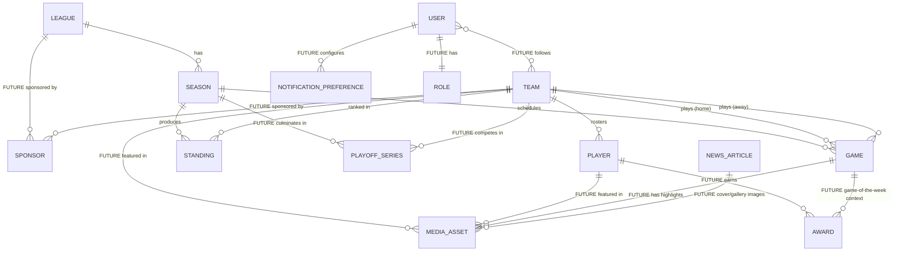

# Entity-Relationship Documentation

The full data model for AZHL — Phase 1's implemented schema plus every entity the product vision
implies for later phases. Owned by the **Database Engineer** agent. See
[database-guidelines.md](./database-guidelines.md) for modeling/migration conventions and
[roadmap.md](./roadmap.md) for which phase introduces which future entity below.

Status legend: **IMPLEMENTED** (real, in `packages/database/prisma/schema.prisma` today) ·
**FUTURE — not yet migrated** (documented intent, no Prisma model exists yet — do not build ahead
of this; see [product-vision.md](./product-vision.md)'s non-goals section).

## Diagram

Relationships across the full product, including the extension points future entities attach to
(e.g. `Player` will later relate to `Award` and `MediaAsset`; `Game` will later relate to
`MediaAsset` for highlight clips). `FUTURE` labels on edges mark relationships that don't exist in
the database yet.

## Phase 1 entities (IMPLEMENTED)

Fields below mirror `packages/database/prisma/schema.prisma` exactly — if this table and the
schema file ever disagree, the schema file wins; update this doc to match.

### League — IMPLEMENTED

| Field | Type | Notes |
|---|---|---|
| `id` | `String` (cuid) | PK |
| `name` | `String` | e.g. "Azerbaijan Hockey League" |
| `shortName` | `String` | e.g. "AZHL" |
| `slug` | `String` | unique |
| `seasons` | `Season[]` | one-to-many |
| `createdAt` / `updatedAt` | `DateTime` | standard timestamps |

### Season — IMPLEMENTED

| Field | Type | Notes |
|---|---|---|
| `id` | `String` (cuid) | PK |
| `leagueId` | `String` | FK → `League`, `onDelete: Cascade` |
| `label` | `String` | e.g. "2025-26" |
| `startDate` / `endDate` | `DateTime` | season window |
| `isCurrent` | `Boolean` | drives "current season" lookups; indexed with `leagueId` |
| `games` | `Game[]` | one-to-many |
| `standings` | `Standing[]` | one-to-many |

### Team — IMPLEMENTED

| Field | Type | Notes |
|---|---|---|
| `id` | `String` (cuid) | PK |
| `name` | `String` | e.g. "Glacier" |
| `city` | `String` | e.g. "Anchorage" |
| `slug` | `String` | unique |
| `abbreviation` | `String` | unique, e.g. "ANC" |
| `colorPrimary` / `colorSecondary` / `colorAccent` | `String` | hex, admin-authored brand colors — see [component-library.md](./component-library.md#palettecontrast-method-for-stat-tile-and-table-components) for the contrast-safe usage rule |
| `logoUrl` | `String?` | optional |
| `players` | `Player[]` | one-to-many |
| `homeGames` / `awayGames` | `Game[]` | two named relations to `Game` |
| `standings` | `Standing[]` | one-to-many |

### Player — IMPLEMENTED (minimal Phase 1 shape)

| Field | Type | Notes |
|---|---|---|
| `id` | `String` (cuid) | PK |
| `teamId` | `String` | FK → `Team`, `onDelete: Cascade` |
| `fullName` | `String` | — |
| `jerseyNumber` | `Int` | unique per team (`@@unique([teamId, jerseyNumber])`) |
| `position` | `PlayerPosition` enum | `C \| LW \| RW \| D \| G` |

Full profile fields (bio, height/weight, draft info, headshot) are explicitly deferred to
**Phase 2**, along with the `Award` and `MediaAsset` relations below.

### Game — IMPLEMENTED

| Field | Type | Notes |
|---|---|---|
| `id` | `String` (cuid) | PK |
| `seasonId` | `String` | FK → `Season`, `onDelete: Cascade` |
| `status` | `GameStatus` enum | `SCHEDULED \| LIVE \| FINAL \| POSTPONED`, default `SCHEDULED` |
| `startTime` | `DateTime` | — |
| `venue` | `String` | free text |
| `homeTeamId` / `awayTeamId` | `String` | two FKs → `Team` (named relations `HomeTeam`/`AwayTeam`) |
| `homeScore` / `awayScore` | `Int?` | null until the game has started |
| `period` | `Int?` | current period, null unless `LIVE` |

### Standing — IMPLEMENTED (derived, never hand-edited)

| Field | Type | Notes |
|---|---|---|
| `id` | `String` (cuid) | PK |
| `seasonId` / `teamId` | `String` | FKs; unique together (`@@unique([seasonId, teamId])`) |
| `gamesPlayed`, `wins`, `losses`, `otLosses` | `Int` | recomputed from `Game` results |
| `points` | `Int` | `wins * 2 + otLosses` per current seed logic |
| `goalsFor` / `goalsAgainst` | `Int` | — |
| `streak` | `String` | e.g. "W3" (default `""`) |
| `rank` | `Int` | position within the season, drives `StandingsTable` order |
| `updatedAt` | `DateTime` | no `createdAt` — this row is a materialized view, not an authored record |

This table is written exclusively by a standings-recomputation service function, never by a
direct client/admin edit — see [database-guidelines.md](./database-guidelines.md) and
[architecture.md](./architecture.md#revalidation-strategy) for how a `Game` result write triggers
recomputation and cache invalidation.

### NewsArticle — IMPLEMENTED

| Field | Type | Notes |
|---|---|---|
| `id` | `String` (cuid) | PK |
| `slug` | `String` | unique |
| `title` / `excerpt` / `body` | `String` | body is plain text/markdown in Phase 1, not rich structured content |
| `coverImageUrl` | `String?` | optional |
| `publishedAt` | `DateTime` | defaults to now; drives list ordering |

## Future — not yet migrated

These entities are implied by [product-vision.md](./product-vision.md)'s long-term feature list.
None exist in `schema.prisma` today. They're documented here so future schema work extends a
known plan instead of re-deriving relationships from scratch — but **do not create these models
ahead of their phase**; see [roadmap.md](./roadmap.md).

### PlayoffSeries — FUTURE (Phase 3)

Bracket/series state for playoffs. Expected shape: `seasonId` (FK → `Season`), `round` (e.g.
"Quarterfinal"), `teamAId`/`teamBId` (FK → `Team`), `teamAWins`/`teamBWins`, `status` (mirrors the
`GameStatus` pattern: upcoming/in-progress/complete), and a relation to the `Game` rows that make
up the series.

### Award — FUTURE (Phase 3)

League/season honors. Expected shape: `seasonId` (FK → `Season`), `playerId` (FK → `Player`,
nullable if a future team-level award is added), `type` (enum: MVP, Top Scorer, Best Rookie, ...),
`awardedAt`. Relates to `Player` as shown in the diagram above.

### MediaAsset — FUTURE (Phase 5)

Photos and video (highlights, galleries) backed by the Cloudinary adapter described in
[future-services.md](./future-services.md). Expected shape: `type` (`PHOTO \| VIDEO`), `url`,
`caption`, `credit`, plus a relation to whichever entity it illustrates — most likely modeled as
one nullable FK per relatable entity (`playerId?`, `teamId?`, `gameId?`, `newsArticleId?`) rather
than a single polymorphic column, to keep referential integrity enforced by Postgres rather than
application code.

### User / Role — FUTURE (Phase 4)

Backs Auth.js once it moves from scaffolded to real. Expected shape: `User` (`id`, `email`,
provider/session fields per Auth.js's adapter requirements, `roleId` or a direct `role` enum),
`Role` (`FAN`, `ADMIN`, `EDITOR` at minimum — exact set defined by the Security Engineer agent
when Phase 4 starts). This is also when the soft-delete stance in
[database-guidelines.md](./database-guidelines.md#soft-vs-hard-delete) needs revisiting, since
user-authored data (follows, notification preferences, admin-edited content) benefits from
recoverability that Phase 1's admin-managed data doesn't need.

### Sponsor — FUTURE (Phase 5)

Sponsor placements. Expected shape: `name`, `logoUrl`, `tier`, and relations to whichever
entities carry sponsor placements (`League`, `Team` at minimum, per the diagram above).

### NotificationPreference — FUTURE (Phase 5)

Per-user notification settings. Expected shape: `userId` (FK → `User`), `channel` (email/push),
`topic` (e.g. "game start", "final score", "breaking news"), `enabled`.

### Ticketing / Shop — FUTURE (Future phase, stub only)

No concrete shape documented yet — genuinely out of scope until the Future phase per
[roadmap.md](./roadmap.md), which also gates it behind Phase 4 auth (payment-adjacent trust
boundaries need real accounts first). When this phase starts, expect at minimum an `Order`/
`LineItem` pair for shop and a `TicketType`/`Ticket` pair for ticketing, both relating to `User`
and (for ticketing) `Game`. Left intentionally unspecified beyond this pointer — see
[future-services.md](./future-services.md) for the architectural placeholder and go-live
conditions.
